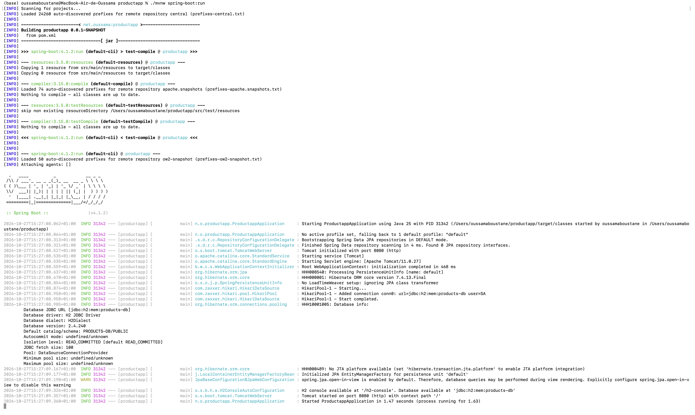

# ProductApp : Gestion de produits avec Spring Boot et Spring Data JPA

Application Java de gestion de produits, réalisée avec **Spring Boot**, **Spring Data JPA (Hibernate)** et une base de données **H2** en mémoire. Elle illustre les opérations CRUD (création, lecture, mise à jour, suppression) à travers une interface `JpaRepository`.

## Table des matières

1. [Objectifs](#objectifs)
2. [Technologies utilisées](#technologies-utilisées)
3. [Prérequis](#prérequis)
4. [Architecture du projet](#architecture-du-projet)
5. [Étapes de réalisation](#étapes-de-réalisation)
6. [Opérations testées](#opérations-testées)
7. [Résultat attendu](#résultat-attendu)
8. [Lancer le projet](#lancer-le-projet)
9. [Auteur](#auteur)

## Objectifs

- Créer un projet Spring Boot avec Spring Initializr dans IntelliJ IDEA
- Définir une entité JPA `Product`
- Configurer la source de données H2 dans `application.properties`
- Créer un repository basé sur Spring Data JPA
- Tester les opérations de gestion de produits : ajout, consultation, recherche, mise à jour et suppression

## Technologies utilisées

| Technologie | Rôle |
|---|---|
| Java 21 | Langage |
| Spring Boot 4.1.2 | Framework principal |
| Spring Web | Couche web |
| Spring Data JPA | Accès aux données (Hibernate) |
| H2 Database | Base de données en mémoire |
| Lombok | Génération des getters, setters et constructeurs |
| Maven | Gestion des dépendances |
| IntelliJ IDEA Ultimate | IDE |

## Prérequis

- JDK 21 installé
- IntelliJ IDEA (ou tout IDE compatible Maven)
- Git

## Architecture du projet

```
productapp
├── pom.xml
├── README.md
└── src
    └── main
        ├── java/net/oussama/productapp
        │   ├── ProductappApplication.java   # Classe principale + tests (CommandLineRunner)
        │   ├── entities
        │   │   └── Product.java             # Entité JPA
        │   └── repository
        │       └── ProductRepository.java   # Interface Spring Data JPA
        └── resources
            └── application.properties       # Configuration H2 et JPA
```

## Étapes de réalisation

### 1. Création du projet

Projet généré avec **Spring Initializr** (intégré à IntelliJ) :

- Type : Maven, Langage : Java 21, Packaging : Jar
- Group : `net.oussama`, Artifact : `productapp`
- Dépendances : Spring Web, Spring Data JPA, H2 Database, Lombok

### 2. Entité JPA `Product`

| Attribut | Type |
|---|---|
| id | Long |
| name | String |
| price | double |
| quantity | int |

```java
@Entity
@Data
@NoArgsConstructor
@AllArgsConstructor
@Builder
public class Product {
    @Id
    @GeneratedValue(strategy = GenerationType.IDENTITY)
    private Long id;
    private String name;
    private double price;
    private int quantity;
}
```

### 3. Configuration de l'unité de persistance

Fichier `src/main/resources/application.properties` :

```properties
spring.application.name=productapp
server.port=8080

spring.datasource.url=jdbc:h2:mem:products-db
spring.datasource.driver-class-name=org.h2.Driver
spring.datasource.username=sa
spring.datasource.password=

spring.h2.console.enabled=true

spring.jpa.hibernate.ddl-auto=create-drop
spring.jpa.show-sql=true
```

### 4. Repository Spring Data JPA

```java
public interface ProductRepository extends JpaRepository<Product, Long> {
    List<Product> findByNameContainsIgnoreCase(String keyword);
    List<Product> findByPriceGreaterThan(double price);
}
```

`JpaRepository` fournit déjà `save`, `findAll`, `findById` et `deleteById`. Les deux méthodes ajoutées sont générées par Spring Data à partir de leur nom.

## Opérations testées

Les opérations sont exécutées au démarrage dans `ProductappApplication` grâce à un `CommandLineRunner` :

| Opération | Méthode utilisée |
|---|---|
| Ajouter des produits | `save(product)` |
| Consulter tous les produits | `findAll()` |
| Consulter un produit | `findById(id)` |
| Chercher des produits | `findByNameContainsIgnoreCase(keyword)`, `findByPriceGreaterThan(price)` |
| Mettre à jour un produit | `save(product)` sur un produit existant |
| Supprimer un produit | `deleteById(id)` |




## Auteur

**Oussama Boustane**, Université Mundiapolis
