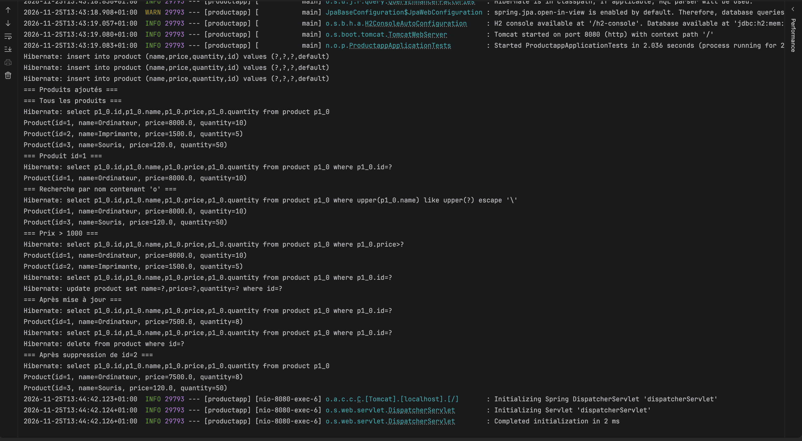
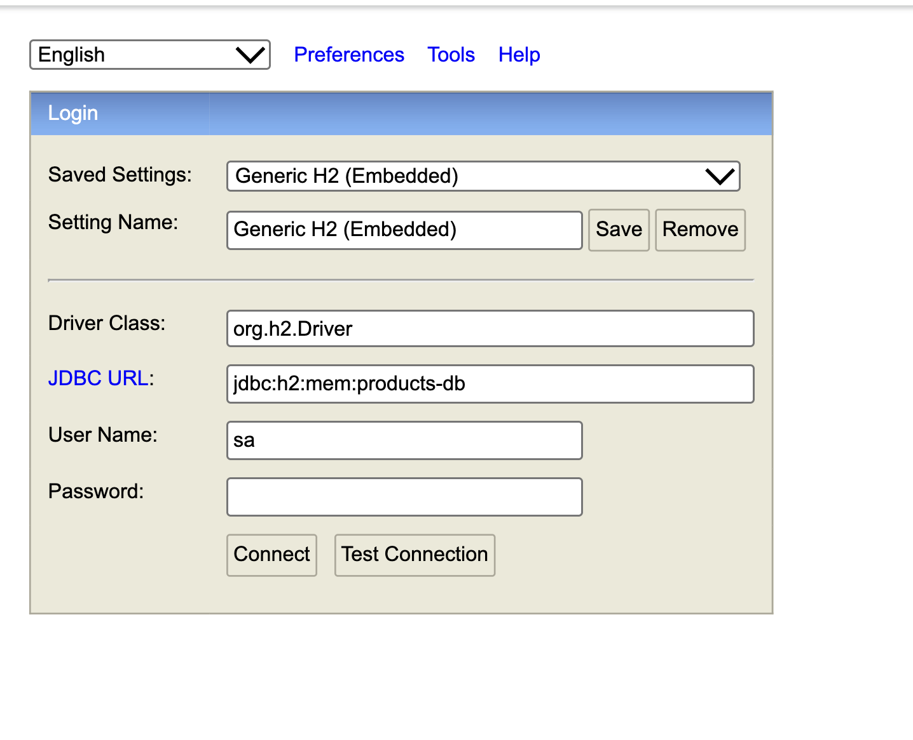
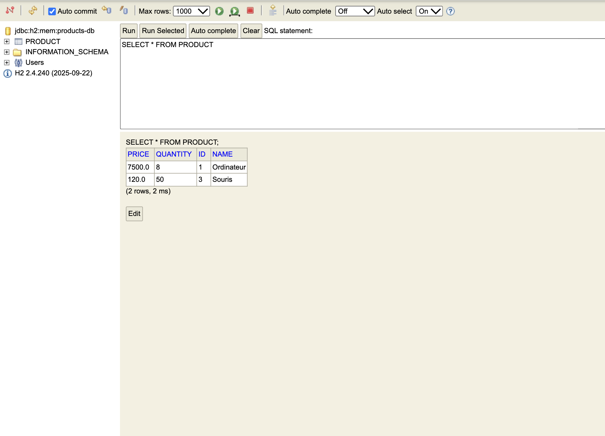

# Activité Pratique N°2 : ORM, JPA, Hibernate et Spring Data

Compte rendu de l'activité pratique portant sur la mise en œuvre de la couche de persistance d'une application Java EE avec **Spring Boot**, **Spring Data JPA**, **Hibernate** et une base de données relationnelle en mémoire **H2**.

- **Étudiant :** Oussama Boustane
- **Établissement :** Université Mundiapolis — Cycle Ingénieur Informatique
- **Module :** Architecture JEE & Systèmes Distribués
- **Dépôt GitHub :** [oboussamaboustane-eng/productapp](https://github.com/oboussamaboustane-eng/productapp)

---

## Table des matières

1. [Objectifs de l'activité](#1-objectifs-de-lactivité)
2. [Architecture et concepts clés](#2-architecture-et-concepts-clés)
3. [Stack technique](#3-stack-technique)
4. [Structure du projet](#4-structure-du-projet)
5. [Étapes d'implémentation](#5-étapes-dimplémentation)
6. [Résultats d'exécution et captures d'écran](#6-résultats-dexécution-et-captures-décran)
7. [Installation et exécution](#7-installation-et-exécution)

---

## 1. Objectifs de l'activité

- Initialiser un projet Spring Boot via **Spring Initializr** sous IntelliJ IDEA.
- Comprendre le mapping Objet-Relationnel (**ORM**) à travers la spécification **JPA** et son implémentation **Hibernate**.
- Configurer une base de données **H2** et activer sa console d'administration web.
- Exploiter **Spring Data JPA** (`JpaRepository`) pour automatiser les opérations CRUD et créer des méthodes de recherche personnalisées.
- Valider l'ensemble des traitements (ajout, consultation, recherche, mise à jour et suppression) au démarrage de l'application.

---

## 2. Architecture et concepts clés

L'application repose sur une architecture en couches assurant un **couplage faible** :

- **JPA (Java Persistence API) :** spécification standard Java définissant les annotations de mapping (`@Entity`, `@Id`, `@GeneratedValue`).
- **Hibernate :** implémentation concrète (moteur ORM) de JPA, chargée de générer dynamiquement les requêtes SQL et de synchroniser les objets Java avec les tables relationnelles.
- **Spring Data JPA :** couche d'abstraction au-dessus de JPA/Hibernate qui élimine le code répétitif de la couche DAO grâce à l'interface générique `JpaRepository`.

---

## 3. Stack technique

| Technologie | Version / Détail | Rôle |
| :--- | :--- | :--- |
| **Java (JDK)** | Java 21 | Langage de programmation |
| **Spring Boot** | 3.x | Framework d'application et conteneur IoC |
| **Spring Data JPA** | Hibernate ORM | Persistance des données et mapping SQL |
| **H2 Database** | En mémoire (`mem`) | SGBD relationnel léger pour les tests |
| **Lombok** | Annotations | Génération automatique des getters, setters, constructeurs et Builder |
| **Maven** | Gestionnaire de build | Gestion des dépendances et cycle de vie du projet |

---

## 4. Structure du projet

```text
productapp
├── pom.xml
├── README.md
├── screenshots
│   ├── console_run.png
│   ├── h2_login.png
│   └── h2_table.png
└── src
    ├── main
    │   ├── java/net/oussama/productapp
    │   │   ├── ProductappApplication.java
    │   │   ├── entities
    │   │   │   └── Product.java
    │   │   └── repository
    │   │       └── ProductRepository.java
    │   └── resources
    │       └── application.properties
    └── test
        └── java/net/oussama/productapp
            └── ProductappApplicationTests.java
```

---

## 5. Étapes d'implémentation

### 5.1. Création de l'entité JPA `Product`

```java
package net.oussama.productapp.entities;

import jakarta.persistence.Entity;
import jakarta.persistence.GeneratedValue;
import jakarta.persistence.GenerationType;
import jakarta.persistence.Id;
import lombok.*;

@Entity
@Data
@NoArgsConstructor
@AllArgsConstructor
@Builder
public class Product {
    @Id
    @GeneratedValue(strategy = GenerationType.IDENTITY)
    private Long id;
    private String name;
    private double price;
    private int quantity;
}
```

### 5.2. Configuration de la persistance (`application.properties`)

```properties
spring.application.name=productapp
server.port=8080

spring.datasource.url=jdbc:h2:mem:products-db
spring.datasource.driver-class-name=org.h2.Driver
spring.datasource.username=sa
spring.datasource.password=

spring.h2.console.enabled=true

spring.jpa.hibernate.ddl-auto=create-drop
spring.jpa.show-sql=true
```

### 5.3. Interface Spring Data `ProductRepository`

```java
package net.oussama.productapp.repository;

import net.oussama.productapp.entities.Product;
import org.springframework.data.jpa.repository.JpaRepository;
import java.util.List;

public interface ProductRepository extends JpaRepository<Product, Long> {
    List<Product> findByNameContainsIgnoreCase(String keyword);
    List<Product> findByPriceGreaterThan(double price);
}
```

### 5.4. Tests des opérations CRUD (`CommandLineRunner`)

Un bean `CommandLineRunner` exécute séquentiellement les 6 scénarios de gestion des produits au démarrage :

1. **Ajout** de 3 produits (Ordinateur, Imprimante, Souris) via `save()`.
2. **Consultation globale** de tous les produits via `findAll()`.
3. **Consultation unitaire** du produit `id = 1` via `findById(1L)`.
4. **Recherche multicritère** par mot-clé (`findByNameContainsIgnoreCase("o")`) et par seuil de prix (`findByPriceGreaterThan(1000)`).
5. **Mise à jour** du prix (`7500.0`) et de la quantité (`8`) du produit `id = 1` via `save()`.
6. **Suppression** du produit `id = 2` via `deleteById(2L)` et vérification de l'état final.

---

## 6. Résultats d'exécution et captures d'écran

### 6.1. Trace d'exécution et requêtes SQL Hibernate dans IntelliJ IDEA

La console affiche le démarrage du serveur Tomcat sur le port 8080, les instructions DDL/DML exécutées par Hibernate (`insert`, `select`, `update`, `delete`) ainsi que le résultat de chaque opération :



### 6.2. Accès à la console d'administration H2

Connexion à l'interface web H2 via `http://localhost:8080/h2-console` avec l'URL JDBC `jdbc:h2:mem:products-db` et l'utilisateur `sa` :



### 6.3. Vérification de la table `PRODUCT` après transactions

Exécution de la requête `SELECT * FROM PRODUCT` confirmant la persistance des modifications : l'article **Ordinateur** (`ID=1`) a bien été mis à jour (`PRICE=7500.0`, `QUANTITY=8`) et l'article **Imprimante** (`ID=2`) a été supprimé :



---

## 7. Installation et exécution

1. Cloner le dépôt :

   ```bash
   git clone https://github.com/oboussamaboustane-eng/productapp.git
   cd productapp
   ```

2. Ouvrir le projet dans **IntelliJ IDEA** et laisser Maven résoudre les dépendances du fichier `pom.xml`.

3. Exécuter la classe `ProductappApplication` (ou `ProductappApplicationTests`).

4. Consulter la base H2 dans un navigateur à l'adresse [http://localhost:8080/h2-console](http://localhost:8080/h2-console).